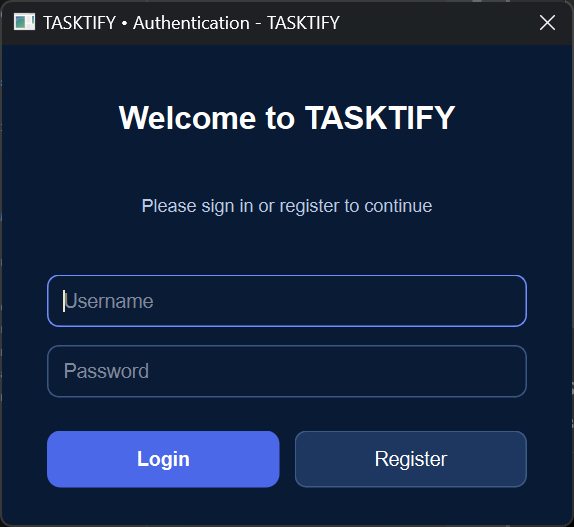
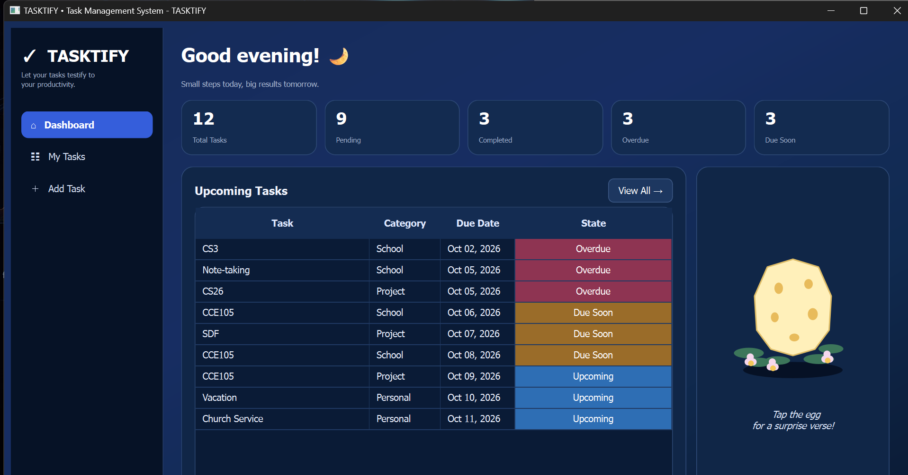
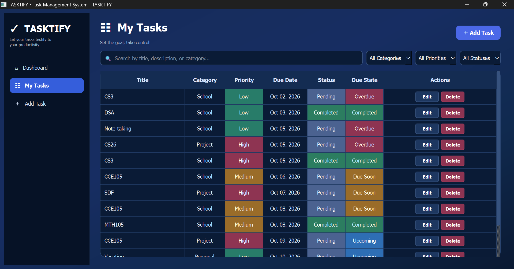
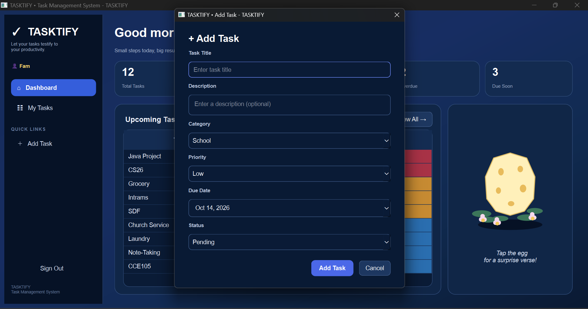
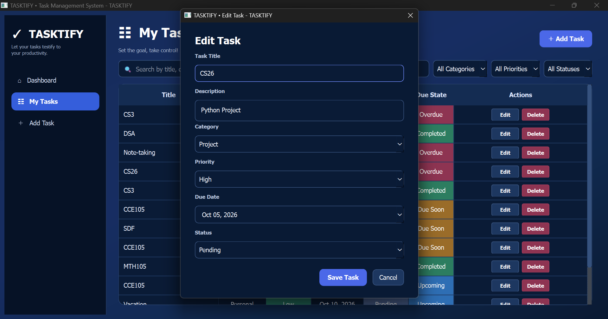
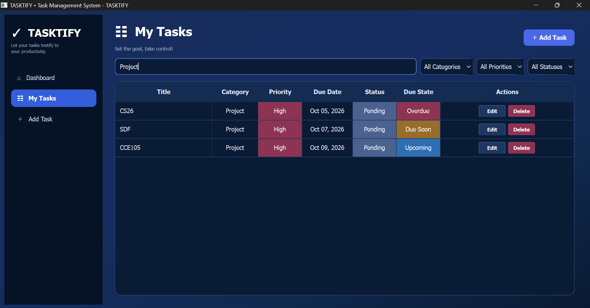
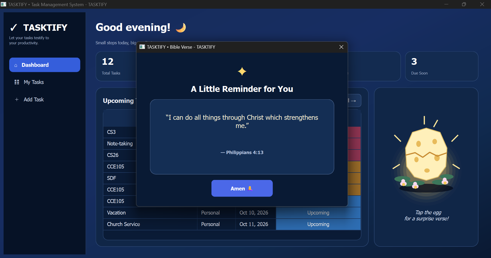

# TASKTIFY: A Task Management System

---

TASKTIFY is a desktop-based task management system developed using Python and PyQt6. It allows users to create, view, update, and delete tasks while keeping track of important task information such as title, description, category, priority, due date, and status.

The system uses SQLite as its database for storing task records. It also provides a dashboard where users can view task statistics and upcoming tasks. An Easter Egg feature is also included, which displays a randomly selected Bible verse.

TASKTIFY was developed using modular programming and Object-Oriented Programming (OOP) to organize the system into separate modules based on their responsibilities.

---

## Objectives

---

The main objectives of TASKTIFY are:

- To provide a simple task management system with user registration and login.
- To allow users to create, view, update, and delete tasks.
- To organize tasks using categories and priorities.
- To monitor task status and due dates.
- To provide search and filtering functions.
- To store user accounts and task information using an SQLite database.
- To keep each user's task list separate.
- To apply modular programming in organizing the project.
- To apply Object-Oriented Programming concepts.
- To provide a dashboard for monitoring tasks.
- To include an Easter Egg feature that provides motivational Bible verses.

---

## Features

---

| # | Feature | Description | Functions / Details |
|---|---|---|---|
| 1 | **User Authentication** | Allows users to create an account and access TASKTIFY by logging in. | Register, log in, password hashing, and sign out |
| 2 | **Dashboard** | Provides an overview of the currently logged-in user's tasks. | Total Tasks, Pending Tasks, Completed Tasks, Overdue Tasks, Due Soon Tasks, Upcoming Tasks, and access to the Easter Egg |
| 3 | **Task Management** | Allows users to manage their task records through the My Tasks page. | Add, view, edit, delete, search, and filter tasks |
| 4 | **Add Task** | Allows users to create a new task and save it to the database. | Task Title, Description, Category, Priority, Due Date, and Status |
| 5 | **Edit Task** | Allows users to modify an existing task. | Update the title, description, category, priority, due date, or status |
| 6 | **Delete Task** | Allows users to remove an existing task from the database. | Delete task with a confirmation dialog |
| 7 | **Search and Filtering** | Helps users find and organize tasks. | Search by title, description, or category; filter by category, priority, or status |
| 8 | **Clear Filters** | Resets the search and filter controls. | Clears the search field and returns the category, priority, and status filters to their default selections |
| 9 | **Task Status** | Allows users to track the current status of a task. | Pending and Completed |
| 10 | **Due-Date Tracking** | Determines a task's due state based on its due date and status. | Upcoming, Due Soon, Overdue, and Completed; Due Soon is used for tasks whose due dates fall within two days |
| 11 | **Quick Links** | Provides a shortcut to task creation from the sidebar. | Add Task shortcut |
| 12 | **Easter Egg** | Provides an interactive egg that reveals a randomly selected Bible verse. | Egg interaction, random verse selection, and verse display dialog |

---

### DETAILED DESCRIPTIONS OF MAJOR FEATURES AND OPERATIONS

---

1. #### USER AUTHENTICATION

| Operation | Description |
|---|---|
| **Register** | Allows a new user to create an account by entering a username and password. The system checks the submitted information and prevents registration with a username that is already in use. |
| **Login** | Checks the entered username and password against the registered account. If the credentials are valid, the user can access the main TASKTIFY window. |
| **Password Hashing** | Converts the password into a hash before storing it in the database. The current implementation uses Python's `hashlib` SHA-256 function. |
| **User-Specific Task Access** | Associates tasks with the logged-in user's ID so that each account can access its own task records. |
| **Sign Out** | Ends the current session in the application and returns the user to the authentication screen. |

2. #### DASHBOARD

The Dashboard summarizes the logged-in user's task information.

| Operation / Statistic | Description |
|---|---|
| **Total Tasks** | Displays the total number of tasks belonging to the logged-in user, including pending and completed tasks. |
| **Pending Tasks** | Displays the number of tasks that have not yet been marked as completed. |
| **Completed Tasks** | Displays the number of tasks marked as completed. |
| **Overdue Tasks** | Displays pending tasks whose due dates have already passed. |
| **Due Soon Tasks** | Displays pending tasks with due dates within the next two days, according to the application's due-date rules. |
| **Upcoming Tasks** | Shows task information related to approaching or scheduled due dates so the user can monitor what needs attention. |
| **Greeting** | Displays a greeting for the currently logged-in user. |
| **Easter Egg Access** | Lets the user interact with the Easter Egg feature to reveal a Bible verse. |

3. #### TASK MANAGEMENT

| Operation | Description |
|---|---|
| **Add Task** | Opens the task form so the user can enter a title, description, category, priority, due date, and status. After validation, the task is saved to the database. |
| **View Tasks** | Displays the logged-in user's saved tasks in the My Tasks table. |
| **Edit Task** | Opens the selected task's information so the user can make changes and save the updated record. |
| **Delete Task** | Asks the user to confirm the deletion before removing the selected task from the database. |
| **Task Validation** | Checks the task information before saving it, helping prevent incomplete or invalid task entries. |
| **Task Categories** | Groups tasks into School, Project, Personal, or Other. |
| **Task Priorities** | Lets the user assign Low, Medium, or High priority to a task. |
| **Task Status** | Lets the user mark a task as Pending or Completed. |

4. #### SEARCH AND FILTERING

| Operation | Description |
|---|---|
| **Search** | Searches task information using the title, description, or category entered by the user. |
| **Category Filter** | Shows tasks that match the selected category. |
| **Priority Filter** | Shows tasks that match the selected priority. |
| **Status Filter** | Shows tasks that match the selected status. |
| **Combined Filters** | Allows the search and selected filters to be used together to narrow the displayed task list. |
| **Clear** | Clears the search text and resets the category, priority, and status filters to their default selections. |

5. #### DUE-DATE TRACKING

| Due State | Description |
|---|---|
| **Upcoming** | Indicates a task that is not yet due soon or overdue, based on the application's due-date rules. |
| **Due Soon** | Indicates a pending task whose due date is within the next two days. |
| **Overdue** | Indicates a pending task whose due date has passed. |
| **Completed** | Indicates that the task has been marked as completed. |

6. #### QUICK LINKS

| Operation | Description |
|---|---|
| **Add Task Shortcut** | Opens the Add Task page from the Quick Links section in the sidebar, giving the user a direct way to create a task. |

7. #### EASTER EGG

| Operation | Description |
|---|---|
| **Egg Interaction** | Allows the user to interact with the Easter Egg on the dashboard. |
| **Random Verse Selection** | Selects a Bible verse from the predefined collection. |
| **Verse Display** | Shows the selected Bible verse in a dialog window. |


---

## Technologies Used

---

| Category | Technologies / Tools |
|---|---|
| Programming Language | Python |
| GUI Framework | PyQt6 |
| Database | SQLite, Python `sqlite3` module |
| Python Libraries and Modules | `sqlite3`, `pathlib`, `dataclasses`, `random`, `datetime`, `sys`, `hashlib` |
| PyQt6 Modules | `PyQt6.QtWidgets`, `PyQt6.QtCore`, `PyQt6.QtGui` |
| Development Tools | PyCharm, Git, GitHub |

---

## Project Structure

---

```text
TASKTIFY_/
├── main.py                         # Entry point; initializes authentication and the application
├── main_window.py                  # Main window, dashboard, task management, and feature integration
├── styles.py                       # Custom PyQt6 styles for the TASKTIFY interface
│ 
├── database/
│   └── database.py                 # SQLite connection and database table setup
│
└── features/
    ├── authentication/             # User registration and login
    │   ├── model.py                # User data structure
    │   ├── repository.py           # User database operations
    │   ├── service.py              # Authentication logic and validation
    │   └── view.py                 # Login and registration interface
    │
    ├── easter_egg/                 # Easter Egg feature for displaying random Bible verses
    │   ├── model.py                # Verse data structure
    │   ├── repository.py           # Stores and retrieves available Bible verses
    │   ├── service.py              # Verse-related logic
    │   └── view.py                 # Easter Egg interface and verse dialog
    │
    └── tasks/                      # Task management and CRUD operations
        ├── model.py                # Task data structure
        ├── repository.py           # SQL operations for task records
        ├── service.py              # Task validation and business logic
        └── view.py                 # Task entry and editing dialogs
```

### Main Components

`main.py`  
Serves as the entry point of TASKTIFY. It initializes the application and database, displays the authentication screen, and opens the main window after a successful login. Signing out returns the user to the authentication screen.

`database/database.py`  
Handles the SQLite database connection and creates the users and tasks tables. It also provides functions for executing database queries.

`features/authentication/`  
Handles user registration and login, including account validation and user record storage.

`features/tasks/`  
Handles task data, validation, database operations, CRUD operations, due-date processing, searching, filtering, and the task interface. Task records are associated with the logged-in user's ID.

`features/easter_egg/`  
Handles the Easter Egg feature, including Bible verse data, random verse selection, the egg interaction, and the verse display interface.

`main_window.py`  
Contains the main TASKTIFY interface and connects the dashboard, My Tasks page, Quick Links, task operations, search and filtering, task statistics, upcoming tasks, and Easter Egg feature.

`styles.py`  
Contains the custom PyQt6 styles used throughout the TASKTIFY graphical interface, including the main window, buttons, tables, dialogs, and input fields.

`tasktify.db`  
Contains the local SQLite database used to store registered user accounts and task records.


---

## Installation and Setup

---

### Requirements:

Before running TASKTIFY, make sure the following are installed:

- Python 
- PyQt6
- Git, if cloning the project from GitHub

### 1. Clone the Repository

```bash
git clone https://github.com/frd-1/TASKTIFY_.git
cd TASKTIFY_
```
### 2. Create a Virtual Environment (Optional)

```bash
python -m venv .venv
```

### 3. Activate the Virtual Environment

**Windows:**

```bash
.venv\Scripts\activate
```

**macOS/Linux:**

```bash
source .venv/bin/activate
```

### 4. Install PyQt6

```bash
pip install PyQt6
```

### 5. Run the Application

```bash
python main.py
```

The application connects to the local SQLite database and uses `tasktify.db` to store user accounts and task records.

---


## How to Use the System

---

### STEP 1: OPEN TASKTIFY

Run:

```bash
python main.py
```

The login and registration screen will appear. Register an account if you are a new user, then log in to open the main TASKTIFY window.

### STEP 2: DASHBOARD

The Dashboard displays the logged-in user's task statistics, upcoming tasks, greeting, and access to the Easter Egg.

### STEP 3: ADDING A TASK

Select **Add Task** or use the Add Task shortcut in **Quick Links**. Enter:

• Title
• Description
• Category
• Priority
• Due Date
• Status

Save the task to store it in the database.

### STEP 4: VIEWING TASKS

Open **My Tasks** to view the saved tasks associated with the logged-in account.

### STEP 5: SEARCHING TASKS

Enter a keyword in the search field. The system searches through the task's:

• Title
• Description
• Category

### STEP 6: FILTERING TASKS

Use the filters to filter tasks by:

• Category
• Priority
• Status

Click **Clear** to remove the search text and reset all filters.

### STEP 7: EDITING A TASK

Select an existing task and use the edit function to modify its information.

### STEP 8: DELETING A TASK

Select an existing task and confirm the deletion to remove it from the database.

### STEP 9: EASTER EGG

Click or interact with the Easter Egg feature from the dashboard to reveal a randomly selected Bible verse.

### STEP 10: SIGNING OUT

Click **Sign Out** to return to the authentication screen.

---

## Object-Oriented Programming Implementation

---

TASKTIFY applies Object-Oriented Programming through classes and objects.

### Important Classes

|  Class            | Purpose |
|-------------------|---|
| `Database`        | Handles SQLite database operations |
| `User`            | Represents a registered user |
| `AuthRepository`  | Handles user account database operations |
| `AuthService`     | Handles registration, login, and authentication validation |
| `AuthDialog`      | Provides the login and registration interface |
| `Task`            | Represents a task |
| `TaskRepository`  | Handles task database operations |
| `TaskService`     | Handles task validation and business logic |
| `TaskDialog`      | Provides the task input/edit interface |
| `Verse`           | Represents a Bible verse |
| `VerseRepository` | Stores and selects Bible verses |
| `VerseService`    | Handles verse-related logic |
| `VerseDialog`     | Displays Bible verses |
| `EggWidget`       | Provides the interactive Easter Egg |
| `MainWindow`      | Provides the main application interface |

### Encapsulation

Encapsulation is applied by separating responsibilities among different classes. Database operations are handled by the database and repository classes, while task validation and business logic are handled by `TaskService`.

### Inheritance

PyQt6 classes are extended to create custom GUI components.

Examples include:

```text
MainWindow → QMainWindow
TaskDialog → QDialog
VerseDialog → QDialog
EggWidget → QFrame
```

This allows TASKTIFY to use existing PyQt6 functionality while adding its own behavior.

### Polymorphism

Polymorphism is demonstrated through customized PyQt6 event methods.

For example, `EggWidget` overrides methods such as:

- `mousePressEvent()`
- `paintEvent()`

These allow the widget to respond to user interaction and display the egg differently based on its current state.

### Abstraction

TASKTIFY applies abstraction by hiding the internal implementation of database operations and business logic from the graphical user interface.

For example, `MainWindow` does not need to directly handle SQL statements when managing tasks. Instead, task operations are handled through `TaskService`, `TaskRepository`, and `Database`.

This allows the interface to use the required functionality without directly managing the database implementation.


### Modular Programming

TASKTIFY separates its features into modules according to their responsibilities.

The task feature follows this structure:

```text
model.py
repository.py
service.py
view.py
```

The authentication and Easter Egg features also use separate modules for their data, operations, and interface.

| Module | Responsibility |
|---|---|
| Model | Represents application data |
| Repository | Handles data storage and retrieval |
| Service | Handles validation and business logic |
| View | Handles the graphical user interface |

This structure separates the different responsibilities of the system and makes the project easier to maintain and modify.


---

## Database

---

TASKTIFY uses SQLite for local data storage.

The database file is:

```text
tasktify.db
```

The database is managed through the `Database` class in `database/database.py`.

### Users Table

The `users` table stores registered user information.

| Field | Data Type | Description |
|---|---|---|
| `id` | INTEGER | Primary key and unique user identifier |
| `username` | TEXT | Unique username used to log in |
| `password_hash` | TEXT | Hashed password value |


### TASKS TABLE

The `tasks` table stores task information associated with a user.

| Field | Data Type | Description |
|---|---|---|
| `id` | INTEGER | Primary key and unique task identifier |
| `user_id` | INTEGER | Identifies the user who owns the task |
| `title` | TEXT | Task title |
| `description` | TEXT | Task description |
| `category` | TEXT | Task category |
| `priority` | TEXT | Task priority |
| `due_date` | TEXT | Task due date |
| `status` | TEXT | Current task status |

---

## CRUD Operations

---

TASKTIFY implements the four basic CRUD (Create, Read, Update, Delete) operations to manage task records stored in SQLite. These operations are handled primarily by `TaskRepository`, which communicates with the database to execute the required SQL operations. Task records are associated with the logged-in user's ID.

| Operation | TASKTIFY Function | Specific Implementation |
|---|---|---|
| **Create** | Add a new task | The user enters task details through `TaskDialog`. The information is validated and passed to `TaskRepository`, which inserts the new record into the database. |
| **Read** | View and retrieve tasks | `TaskRepository` retrieves task records from the database. The task objects are displayed in the My Tasks page and Dashboard. |
| **Update** | Edit an existing task | The user modifies task information through `TaskDialog`. The updated values are validated and used to update the corresponding task record. |
| **Delete** | Remove a task | The user confirms deletion, and `TaskRepository` removes the selected task record from the database. |

---

## Search and Filtering

TASKTIFY provides search and filtering functionality to help users locate specific tasks.

### Search

Users can search by:

- Title
- Description
- Category

### Filters

Users can filter tasks by:

- Category
- Priority
- Status

The **Clear** button resets the search field and all filters to their default selections.

---

## Screenshots

---

The following screenshots demonstrate the main features and functions of the TASKTIFY system.

### User Authentication


Shows the login and registration interface where users can enter their username and password to access TASKTIFY or create a new account. This demonstrates the system's user authentication feature.

### Dashboard



Shows the main dashboard after a user successfully logs in. It displays the task statistics, including Total Tasks, Pending, Completed, Overdue, and Due Soon. It also contains the Upcoming Tasks section, Quick Links, and the Easter Egg feature for easy navigation and quick access to important task information.

- `Total Tasks` – Displays the total number of tasks belonging to the logged-in user.
- `Pending` – Shows the number of tasks that have not yet been completed.
- `Completed` – Displays the number of tasks marked as completed.
- `Overdue` – Shows pending tasks whose due dates have already passed.
- `Due Soon` – Displays pending tasks that are approaching their due dates within the system's defined period.
- `Upcoming Tasks` – Displays tasks that still require attention, helping users keep track of their schedules.

### My Tasks



Shows the task management table containing the user's saved tasks. It displays information such as task title, category, priority, due date, status, and due state. The screen also provides actions for editing and deleting tasks.

### Add Task



Shows the form used to create a new task. Users can enter the task title, description, category, priority, and due date. This demonstrates how users add and save tasks to their personal task list.

### Edit Task



Shows the task editing form with the information of an existing task. Users can modify the task details and save the changes, demonstrating the system's task update functionality.

### Search and Filter



Shows the search bar and filter options used to find specific tasks. Users can search by task title, description, or category and filter tasks by category, priority, and status. The Clear button resets the search and filter fields to their default values.

### Easter Egg Feature



Shows the clickable Easter Egg feature on the dashboard and the Bible verse dialog that appears when it is opened. This feature displays a randomly selected Bible verse as an additional interactive element of TASKTIFY.

---

## Testing

---

The following test cases cover the main functions implemented in TASKTIFY.

| Test Area | Test Action | Expected Result | Status |
|---|---|---|---|
| Application | Run `main.py` | Authentication screen opens successfully | Passed |
| Registration | Register with valid account details | Account is created | Passed |
| Login | Log in with valid credentials | The user's main window opens | Passed |
| User Separation | Log in with a different account | The account displays its own task list | Passed |
| Sign Out | Click Sign Out | The authentication screen appears again | Passed |
| Database | Start the application | Database connects successfully | Passed |
| Add Task | Add a valid task | Task is saved and displayed | Passed |
| View Task | Open My Tasks | Saved tasks are displayed | Passed |
| Edit Task | Edit an existing task | Task information is updated | Passed |
| Delete Task | Delete a task | Task is removed | Passed |
| Validation | Enter invalid or incomplete information | Invalid input is rejected | Passed |
| Search | Search for a task | Matching tasks are displayed | Passed |
| Filter | Filter by category, priority, or status | Matching tasks are displayed | Passed |
| Clear Filters | Apply filters and click Clear | Search and filters return to default settings | Passed |
| Due State | Use different due dates | Correct due state is displayed | Passed |
| Dashboard | View task statistics | Task statistics are displayed | Passed |
| Easter Egg | Interact with the egg | A Bible verse is displayed | Passed |
| Data Persistence | Restart the application | Saved tasks remain available | Passed |

---

## Known Issues and Limitations

---

TASKTIFY is designed as a local desktop task management system.

The current system has the following limitations:

- It uses a local SQLite database.
- It does not provide cloud synchronization.
- Task data is not synchronized between devices.
- The Bible verses used by the Easter Egg are predefined.
- The system does not include notifications or reminders.
- The system does not include task export functionality.
- The system does not include automatic database backup.
- Password storage uses SHA-256 hashing; a dedicated password-hashing method with a salt would provide stronger password-storage protection.

These limitations can be addressed in future versions of the project.

---

## Future Improvements

---

Possible improvements for future versions include:

- Cloud database support and synchronization
- Task notifications and reminders
- Task export
- Database backup and restore
- More customization options
- Additional motivational features
- More Bible verses for the Easter Egg
- Stronger password storage using a dedicated password-hashing method

---

## Author

**Name:**  *Francesca Anne Marie B. Delosa*

**Section:** *CS26/L (3581)*


